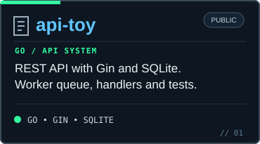
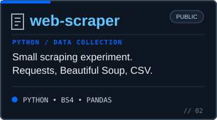
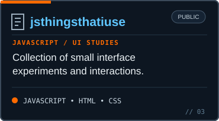

<!-- rppmde / profile README — editable GitHub-native content -->
###  About

I work with software, systems, and the tools that connect them. I'm interested in infrastructure, automation, networking, and making useful things work.

Curiosity first. Real projects over impressive-looking technology lists.

###  Focus

<table>
<tr>
<td valign="top" width="50%">

**WORKING ON**

```text
> building useful tools
> experimenting with Go and Python
> understanding infrastructure
> learning by working on real systems
```

</td>
<td valign="top" width="50%">

**AREAS OF INTEREST**

```text
01  Systems and operations
02  Networking and security
03  Backend and data
04  Automation and tooling
```

</td>
</tr>
</table>

###  Selected work

<table>
<tr>
<td width="33%" valign="top"><a href="https://github.com/rppmde/api-toy"></a></td>
<td width="33%" valign="top"><a href="https://github.com/rppmde/web-scraper"></a></td>
<td width="33%" valign="top"><a href="https://github.com/rppmde/jsthingsthatiuse"></a></td>
</tr>
</table>

###  Tools & technologies

A curated selection of languages, tools, and technologies I use or explore. This isn't a proficiency ranking.

<table>
<tr><td align="center" width="12.5%"></td><td align="center" width="12.5%"></td><td align="center" width="12.5%"></td><td align="center" width="12.5%"></td><td align="center" width="12.5%"></td><td align="center" width="12.5%"></td><td align="center" width="12.5%"></td><td align="center" width="12.5%"></td></tr>
<tr><td align="center" width="12.5%"></td><td align="center" width="12.5%"></td><td align="center" width="12.5%"></td><td align="center" width="12.5%"></td><td align="center" width="12.5%"></td><td align="center" width="12.5%"></td><td align="center" width="12.5%"></td><td align="center" width="12.5%"></td></tr>
</table>

###  Connect

[**GitHub**](https://github.com/rppmde)

<sub>RPPMDE // SYSTEMS · TOOLING · EXPERIMENTS</sub>
