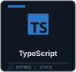
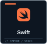
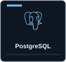
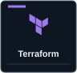
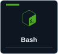
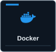
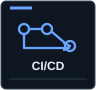
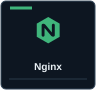

<!-- rppmde / profile README — editable GitHub-native content -->
###  About

I work with software, systems, and the tools that connect them. I'm interested in infrastructure, automation, networking, and making useful things work.

###  Focus

<table>
<tr>
<td valign="top" width="50%">
<strong>WORKING ON</strong>

<samp>
&gt; Build useful tools 
&gt; Explore Go and Python 
&gt; Learn infrastructure 
&gt; Work on real systems
</samp>

</td>
<td valign="top" width="50%">
<strong>AREAS OF INTEREST</strong>

<samp>
01&nbsp; Systems &amp; operations 
02&nbsp; Networking &amp; security 
03&nbsp; Backend &amp; data 
04&nbsp; Automation &amp; tooling
</samp>

</td>
</tr>
</table>

###  Selected work

<table>
  <tr>
    <td width="33%" valign="top">
      
▣ <strong><a href="https://github.com/rppmde/api-toy">api-toy</a></strong> Public

      
Go REST API built with Gin, SQLite, a worker queue, and tests.

      
<code>Go</code> · Gin · SQLite

    </td>
    <td width="33%" valign="top">
      
▣ <strong><a href="https://github.com/rppmde/web-scraper">web-scraper</a></strong> Public

      
Python scraping experiment using Requests, Beautiful Soup, and pandas.

      
<code>Python</code> · Beautiful Soup

    </td>
    <td width="33%" valign="top">
      
▣ <strong><a href="https://github.com/rppmde/jsthingsthatiuse">jsthingsthatiuse</a></strong> Public

      
Small JavaScript interface and interaction experiments.

      
<code>JavaScript</code> · HTML · CSS

    </td>
  </tr>
</table>

###  Tools & technologies

A curated selection of languages, tools, and technologies I use or explore. This isn't a proficiency ranking.

<table>
<tr><td align="center" width="12.5%"></td><td align="center" width="12.5%"></td><td align="center" width="12.5%"></td><td align="center" width="12.5%"></td><td align="center" width="12.5%"></td><td align="center" width="12.5%"></td><td align="center" width="12.5%"></td><td align="center" width="12.5%"></td></tr>
<tr><td align="center" width="12.5%"></td><td align="center" width="12.5%"></td><td align="center" width="12.5%"></td><td align="center" width="12.5%"></td><td align="center" width="12.5%"></td><td align="center" width="12.5%"></td><td align="center" width="12.5%"></td><td align="center" width="12.5%"></td></tr>
</table>
